# Launch a Kubernetes Cluster on Floci

A hands-on rebuild of NextWork's "Launch a Kubernetes Cluster" project that runs entirely on a local AWS emulator ([Floci](https://github.com/floci-io/floci)).
It launches an EC2 instance, hits the missing `eksctl` error, builds the network and IAM roles with CloudFormation,
creates an EKS cluster and node group, adds an access entry, and then deletes the node to watch Kubernetes recover.

No AWS account is used. Everything talks to `http://localhost:4566` with dummy credentials and fake data.

```
 EC2 instance ──► eksctl: not found (127)
      │
      ▼
 CloudFormation (VPC, subnets, NAT, roles) ──► EKS cluster + node group (k3s v1.33)
                                                    │
                       access entry ◄───────────────┤
                                                    ▼
                                     kubectl delete node ► node returns
```

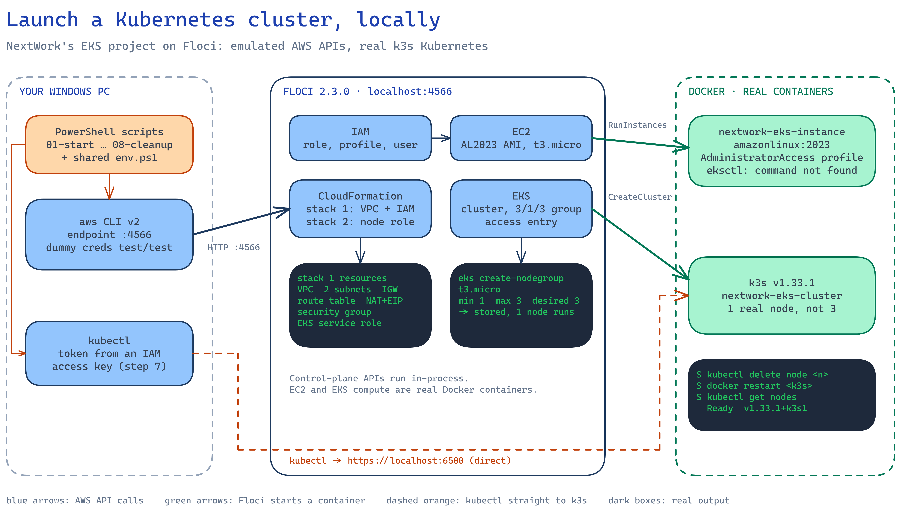

Editable source: [docs/architecture.excalidraw](docs/architecture.excalidraw).

## Requirements

| Tool | Used for |
|---|---|
| Docker Desktop (running) | Floci container, plus the EC2 and EKS node containers it starts |
| AWS CLI v2 | all AWS calls |
| kubectl | step 07 |
| PowerShell 5.1+ | the scripts |

Tested on Windows 11, PowerShell 5.1, AWS CLI 2.39.5 and Floci 2.3.0 (`floci/floci:latest`) as of 2026-11-26.
Each script was run against Floci. `eksctl` is not needed and does not work against an emulator.

## Quick start

```powershell
cd scripts
Set-ExecutionPolicy -Scope Process Bypass   # once per PowerShell window
.\01-start-floci.ps1
.\02-launch-instance.ps1
.\03-eksctl-error.ps1
.\04-create-cluster.ps1
```

Then continue with 05 to 08 below. If something already serves port 4566, step 01 reuses it. All settings (dummy
credentials, endpoint, resource names) live in [scripts/env.ps1](scripts/env.ps1).

## Steps

| # | Script | What it does | Success looks like |
|---|---|---|---|
| 01 | `01-start-floci.ps1` | Starts Floci, or reuses whatever already serves port 4566 | `ec2`, `eks`, `cloudformation`, `iam`, `autoscaling` all `running` |
| 02 | `02-launch-instance.ps1` | Launches a `t3.micro` instance and gives it an AdministratorAccess role | Instance `running` with the `nextwork-eks-instance-role` profile |
| 03 | `03-eksctl-error.ps1` | Runs `eksctl create cluster` inside the instance | `eksctl: command not found`, exit code 127 |
| 04 | `04-create-cluster.ps1` | Creates the cluster and node role stacks, then the cluster and node group | Both stacks `CREATE_COMPLETE`, cluster and node group `ACTIVE` |
| 05 | `05-track-stacks.ps1` | Lists stacks, events and resources | VPC, subnets, gateways, NAT, EIP and roles, all `CREATE_COMPLETE` |
| 06 | `06-access-entry.ps1` | Creates user `nextwork-admin` and an EKS access entry | A `STANDARD` entry for `user/nextwork-admin` |
| 07 | `07-node-resilience.ps1` | Deletes the node, restarts the k3s container, waits for a new node | `No resources found`, then a `Ready` node |
| 08 | `08-cleanup.ps1` | Removes everything the project created | Leftover list is empty |

Run the scripts from the `scripts` folder, once each, in order. To start over, run `08-cleanup.ps1`.

## What gets built

| Layer | Resources |
|---|---|
| Compute | `t3.micro` instance `nextwork-eks-instance` with an instance profile |
| Network (CloudFormation) | VPC `192.168.0.0/16`, two subnets, internet gateway, NAT gateway, Elastic IP, route table, security group |
| IAM (CloudFormation) | EKS service role, node instance role |
| Kubernetes (EKS API) | Cluster `nextwork-eks-cluster` and node group `nextwork-nodegroup` |
| Access | IAM user `nextwork-admin` with an EKS access entry |

The two CloudFormation templates are written by hand in [templates/](templates).

## Screenshots

Terminal output from the scripts, and Floci UI views (`localhost:4500`, optional and not used by the scripts).
All files are in [docs/screenshots](docs/screenshots).

| | |
|---|---|
| 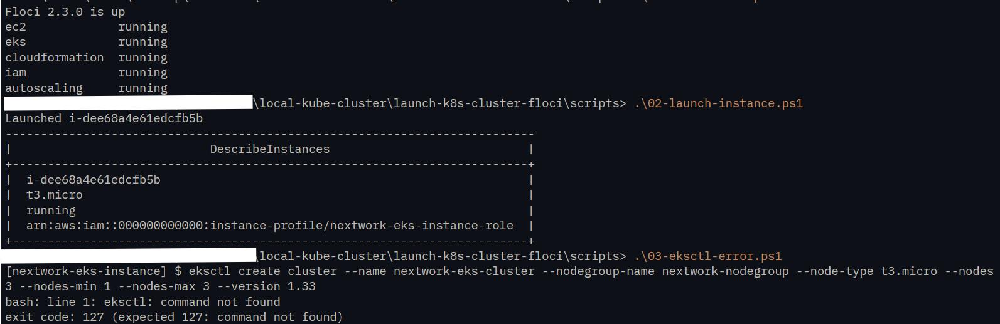 Steps 1 to 3: Floci up, instance launched, `eksctl` not found | 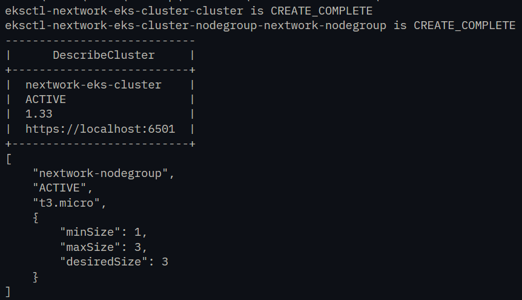 Step 4: both stacks complete, cluster and node group `ACTIVE` |
| 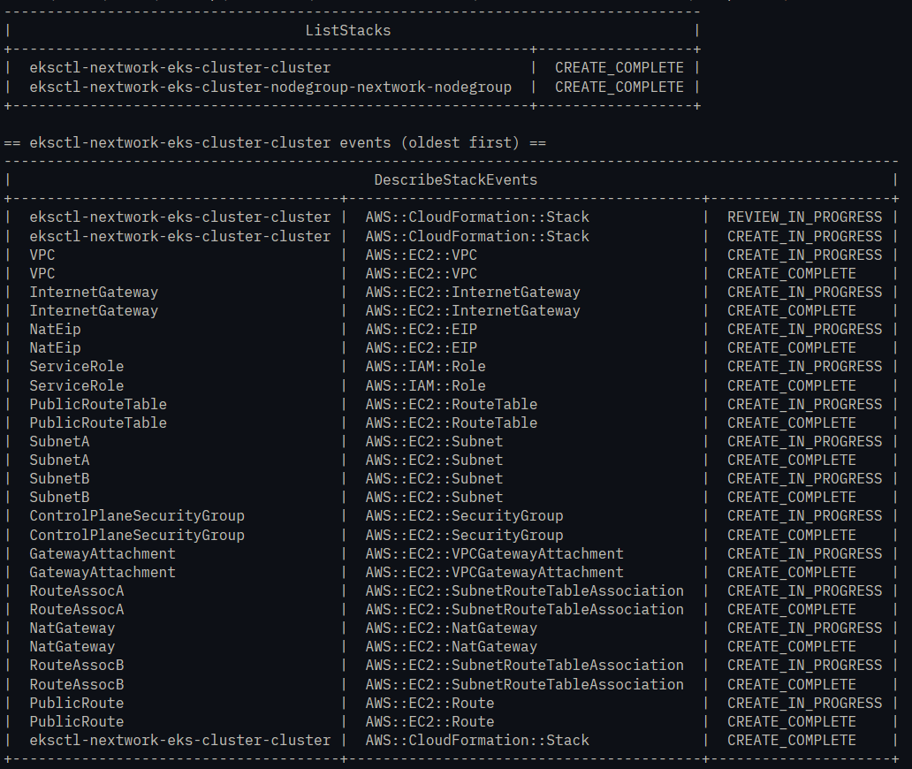 Step 5: stack list, events and resources | 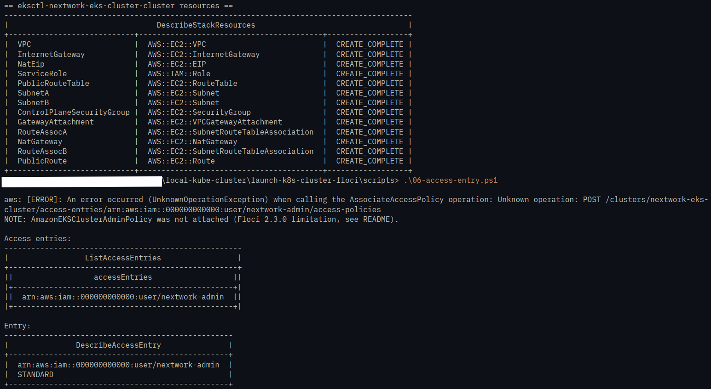 Step 6: access entry created, policy note for the Floci limitation |
| 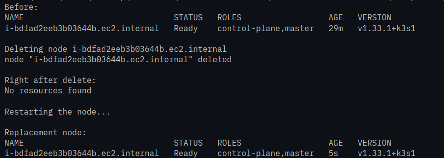 Step 7: node deleted, then a fresh node `Ready` | 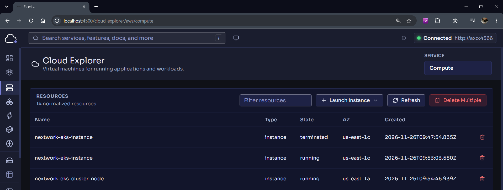 Floci UI: the instance and the EKS node |
| 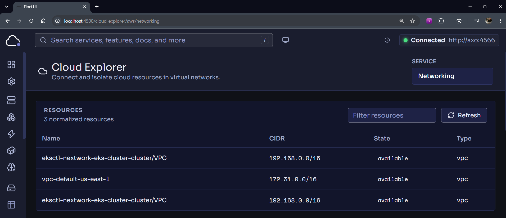 Floci UI: the eksctl-style VPC | 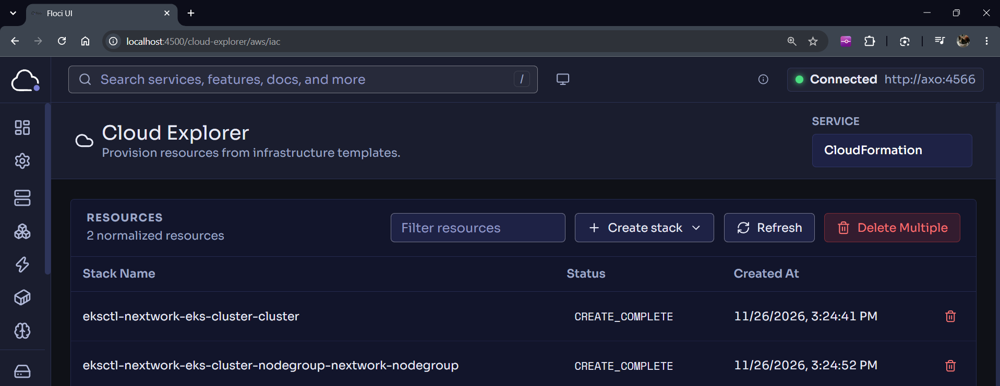 Floci UI: both stacks `CREATE_COMPLETE` |
| 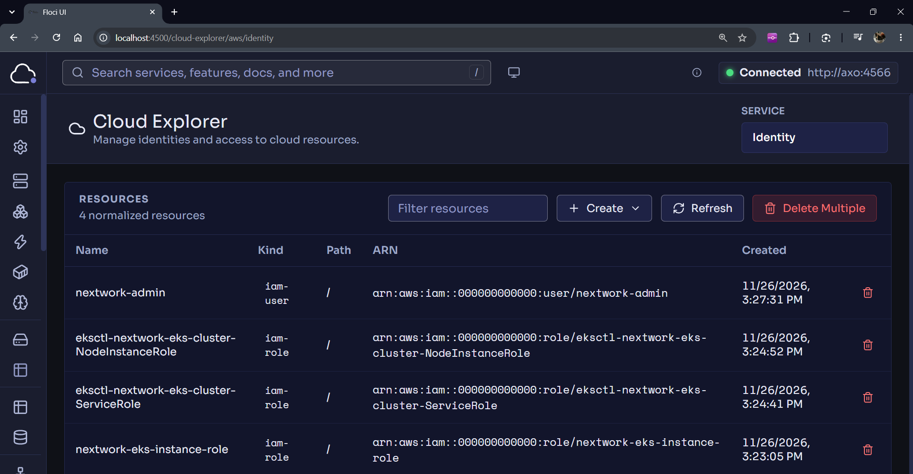 Floci UI: `nextwork-admin` and the three roles | 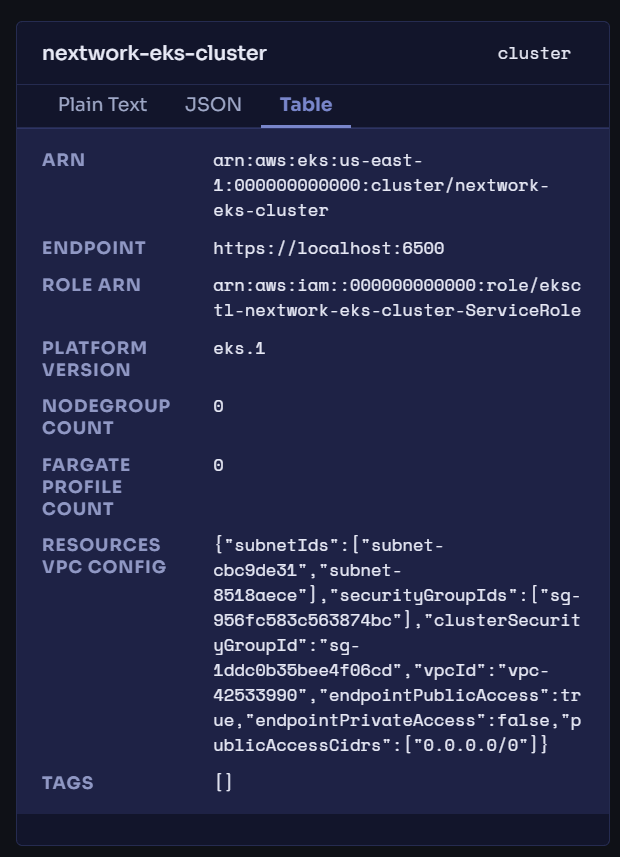 Floci UI: the cluster and its endpoint |

## Project layout

```
scripts/
├── 01-…08-*.ps1     numbered steps, run in order
└── env.ps1          shared settings and helpers (dot-sourced by every script)
templates/
├── cluster.yaml     VPC, subnets, gateways, NAT, security group, service role
└── nodegroup.yaml   node instance role
docs/                architecture diagram, cover, screenshots
.kubeconfig          generated by step 07, gitignored
```

## Limitations

Emulator, not AWS
- No AWS console and no EC2 Instance Connect. The console tours become `describe-*` calls, and `docker exec` into the
  instance container replaces Instance Connect.
- No `eksctl`. It targets real AWS endpoints, so the two stacks it would create are written by hand.
- Floci's CloudFormation ignores `AccessConfig.AuthenticationMode` and the node group's `ScalingConfig` and
  `InstanceTypes` on create. The stacks hold the network and IAM roles, and `04-create-cluster` creates the cluster
  and node group through the EKS API instead.
- One node, not three. Floci runs one k3s container per cluster, so the node group reports 3 desired, 1 minimum and
  3 maximum while a single node exists. `t3.micro` is recorded as metadata only.
- No self-healing through EC2. Floci rejects `TerminateInstances` on cluster nodes and Auto Scaling never replaces
  them. Step 07 deletes the Kubernetes node object and restarts the k3s container so a fresh node registers. That shows
  a node coming back, not an Auto Scaling group replacing an instance.
- On Floci 2.3.0, `associate-access-policy` returns `UnknownOperationException` for every user or role ARN, so
  `AmazonEKSClusterAdminPolicy` is never attached. The entry is created and listed, and the script prints a note.
  Floci does not enforce access policies in any case.
- Floci rejects the shared `test`/`test` pair for `kubectl`, so step 07 signs in with an access key generated for
  `nextwork-admin`. It is fake and local.
- Behaviour was checked against Floci 2.3.0 and the runs above, not against real AWS, and can differ.

Scripts
- They are meant to run once, in order. Running `04` twice fails with `AlreadyExists`; run `08` first.
- Not tested on other Windows, PowerShell or Floci versions.

## Troubleshooting

| Symptom | Fix |
|---|---|
| `Floci did not become healthy` | Start Docker Desktop and check that port 4566 is free (`docker ps`) |
| Script blocked by execution policy | `Set-ExecutionPolicy -Scope Process Bypass` |
| First `04` is slow | Floci pulls the `rancher/k3s` image on the first cluster. Wait for it |
| `Stack ... already exists` or `ROLLBACK_COMPLETE` | Run `08-cleanup.ps1`, then start again from `02` |
| `kubectl` says "provide credentials" | Use step 07, which signs in with the IAM key. Plain `test`/`test` is rejected |
| `LimitExceeded` creating an access key | Run `08-cleanup.ps1`. A user can hold two keys, and `07` clears old ones |
| `07` waits on a missing node | Run `docker restart floci-aws-eks-nextwork-eks-cluster` |
| Everything missing after a restart | Floci is in-memory. Re-run from `02` |

## Cleanup

```powershell
.\08-cleanup.ps1
```

It deletes the node group, cluster, both stacks, the instance, the role and the user, then prints clusters, stacks,
Elastic IPs and live instances. All four lines should be empty. Floci itself keeps running.

## Acknowledgements

- Based on the [NextWork](https://nextwork.ai/) project "Launch a Kubernetes Cluster"
  ([project page](https://nextwork.ai/projects/aa8525df-82a0-5697-8721-a03b2db2c635?track=high)). The steps, resource
  names and learning flow come from there. This repo is an independent local rebuild and is not affiliated with NextWork.
- Runs on [Floci](https://github.com/floci-io/floci), the local AWS emulator.

## License

[MIT](LICENSE). Educational use only: run it against a local emulator, never against an AWS account you care about.
